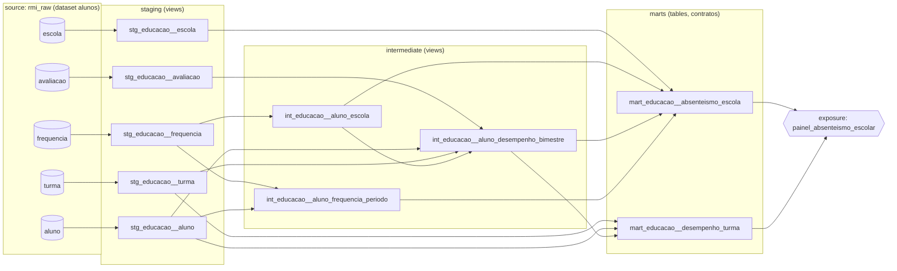

# Desafio Técnico – Cientista de Dados (RMI) · Solução

Projeto **dbt-core + BigQuery** que transforma os registros educacionais anonimizados do
desafio em camadas `staging → intermediate → marts`, com estratégia de testes
documentada, análise exploratória em Python e CI no GitHub Actions.

> Enunciado original: [`prefeitura-rio/desafio-cientista-dados-peqc`](https://github.com/prefeitura-rio/desafio-cientista-dados-peqc).

---

## Sumário

1. [Resultado em 60 segundos](#1-resultado-em-60-segundos)
2. [Arquitetura e lineage](#2-arquitetura-e-lineage)
3. [Como reproduzir](#3-como-reproduzir)
4. [Decisões de modelagem](#4-decisões-de-modelagem)
5. [Estratégia de testes](#5-estratégia-de-testes)
6. [Análise dos marts](#6-análise-dos-marts)
7. [Trade-offs e o que faria com mais tempo](#7-trade-offs-e-o-que-faria-com-mais-tempo)
8. [Estrutura do repositório](#8-estrutura-do-repositório)

---

## 1. Resultado em 60 segundos

| Item | Entrega |
|---|---|
| Sources | 5 tabelas brutas (`aluno`, `escola`, `turma`, `frequencia`, `avaliacao`) no dataset `alunos` |
| Staging | 5 views `stg_educacao__*` com tipagem, renomeação, deduplicação e filtros documentados |
| Intermediate | 3 views: escola principal do aluno, frequência consolidada por período, desempenho bimestral enriquecido |
| Marts | 2 tabelas com **data contracts**: `mart_educacao__absenteismo_escola` e `mart_educacao__desempenho_turma` |
| Testes | 100+ testes genéricos (built-in + `dbt_utils`), 1 teste genérico customizado (`valid_percentage`), 4 testes singulares de regra de negócio / reconciliação |
| Extras | macros, variáveis de negócio, `generate_schema_name`, exposure, tags, hook, `dbt_utils` + `dbt_expectations`, CI com `dbt build`, notebook de EDA (pandas/numpy) |

Principais descobertas que moldaram o projeto (detalhes em [`notebooks/eda.ipynb`](notebooks/eda.ipynb)):

* A tabela `turma` tem **1 linha por aluno** – é a matrícula do ano, não um cadastro de turmas.
* A `frequencia` por disciplina varia só entre 97 % e 100 % (artefato da anonimização); a medida
  com variância real é `avaliacao.frequencia` (frequência geral do bimestre). O indicador de
  absenteísmo usa a segunda.
* `avaliacao` não tem escola, e a turma da `frequencia` quase nunca é a turma de matrícula.
  A escola do aluno é **inferida** da frequência (escola com mais períodos registrados).
* Há duplicatas nas duas tabelas de fatos, 12 % de turmas órfãs na frequência, uma coluna de
  nota 100 % nula e um pico artificial de notas em zero. Cada caso tem tratamento e teste próprios.

---

## 2. Arquitetura e lineage



| Camada | Materialização | Dataset no BigQuery | Papel |
|---|---|---|---|
| staging | `view` | `<dataset>_staging` | 1:1 com a fonte; limpeza, tipagem, nomes padronizados. Sem joins. |
| intermediate | `view` | `<dataset>_intermediate` | Joins e consolidação de grão; regras de negócio reutilizáveis. |
| marts | `table` (clusterizada) | `<dataset>_marts` | Respostas a perguntas de gestão; contratos de schema. |

Views nas duas primeiras camadas mantêm o custo de armazenamento zero e garantem que
qualquer `dbt run` dos marts leia a fonte atual. Os marts são tabelas porque são consultados por
painéis (leitura repetida) e porque o contrato de schema só é verificável em tabelas.
`generate_schema_name` foi sobrescrito para que os datasets sejam previsíveis (`rmi_dbt_staging`,
e não `rmi_dbt_rmi_dbt_staging`).

Convenções de nome: `stg_<fonte>__<entidade>`, `int_<domínio>__<grão/assunto>`,
`mart_<domínio>__<pergunta>`; colunas em `snake_case` português, prefixos `id_`, `qtd_`, `taxa_`,
`percentual_`, `flag_`, `media_`; hashes anonimizados recebem sufixo `_hash`.

---

## 3. Como reproduzir

### 3.1 Pré-requisitos

* Python 3.10–3.13, `gcloud` CLI, um projeto GCP com BigQuery (o Sandbox gratuito basta).
* Os Parquets brutos carregados no dataset `alunos` (abaixo).

```bash
git clone <este-fork> && cd desafio-cientista-dados-peqc
python -m venv .venv && source .venv/bin/activate      # Windows: .venv\Scripts\activate
pip install -r requirements.txt
```

### 3.2 Carregar os dados brutos (uma vez)

```bash
gcloud auth login --update-adc
export DBT_GCP_PROJECT=<seu-projeto>
bq --project_id=$DBT_GCP_PROJECT mk --dataset --location=southamerica-east1 alunos
for t in aluno escola turma frequencia avaliacao; do
  bq --project_id=$DBT_GCP_PROJECT load --source_format=PARQUET alunos.$t gs://case_vagas/rmi/$t
done
```

> Os objetos no bucket não têm extensão `.parquet`. Para o notebook, baixe-os para `data/`:
> `for t in aluno escola turma frequencia avaliacao; do curl -sSL -o data/$t.parquet https://storage.googleapis.com/case_vagas/rmi/$t; done`

### 3.3 Rodar o dbt

O `profiles.yml` está versionado e lê tudo de variáveis de ambiente (sem segredos no repo):

| Variável | Padrão | Descrição |
|---|---|---|
| `DBT_GCP_PROJECT` | – (obrigatória) | projeto GCP |
| `DBT_BQ_DATASET` | `rmi_dbt` | prefixo dos datasets de saída |
| `DBT_BQ_LOCATION` | `southamerica-east1` | location do BigQuery (deve ser a mesma do dataset `alunos`) |
| `DBT_BQ_METHOD` | `oauth` | `service-account` no CI (+ `DBT_GCP_KEYFILE`) |

```bash
export DBT_PROFILES_DIR=. DBT_GCP_PROJECT=<seu-projeto>
dbt deps
dbt build            # run + test de tudo, na ordem do DAG
dbt docs generate && dbt docs serve
```

Se os dados brutos estiverem em outro projeto/dataset, use
`--vars '{raw_project: outro-projeto, raw_dataset: outro_dataset}'`. A tabela de alunos é lida como
`alunos` (nome usado na carga); se a sua se chamar `aluno`, use `--vars '{raw_aluno_table: aluno}'`.
Se `id_aluno` já estiver como STRING, use `--vars '{id_aluno_is_bytes: false}'`.

Seleções úteis: `dbt build --select tag:staging`, `dbt build --select +mart_educacao__absenteismo_escola`,
`dbt ls --select +exposure:painel_absenteismo_escolar`.

### 3.4 Notebook

```bash
jupyter lab notebooks/eda.ipynb
```

---

## 4. Decisões de modelagem

### 4.1 Staging (uma por tabela fonte)

| Model | Grão | Limpeza principal |
|---|---|---|
| `stg_educacao__aluno` | aluno | `id_aluno` BYTES→STRING hex (macro `aluno_id_to_string`); `faixa_etaria` normalizada; `bairro` FLOAT→INT + flag de nulo |
| `stg_educacao__escola` | escola | tipagem; `bairro` → `id_bairro_hash` |
| `stg_educacao__turma` | aluno × turma (matrícula) | `ano` → `ano_letivo`; filtro de chaves nulas |
| `stg_educacao__frequencia` | aluno × turma × escola × disciplina × período | datas STRING→DATE (`SAFE.PARSE_DATE`); código → nome de disciplina (macro `map_disciplina`); `SELECT DISTINCT` para 1.483 cópias exatas; filtro `0..100` |
| `stg_educacao__avaliacao` | aluno × turma × bimestre | `bimestre` STRING→INT; notas renomeadas e limitadas a `0..10`; `ROW_NUMBER` para 34 duplicatas (mantém a linha com mais notas) + `qtd_registros_fonte` |

Princípio: staging **não esconde** problemas da fonte. Duplicatas com o mesmo grão mas valores
diferentes ficam no staging (com teste em `warn`) e são resolvidas na camada intermediate, onde a
regra (média) fica explícita.

### 4.2 Intermediate

**`int_educacao__aluno_escola`** – 1 linha por aluno. A avaliação não traz escola; a única fonte com
`id_escola` é a frequência. Escolhemos a escola com mais períodos de frequência (empate: período mais
recente, depois menor id). 3,6 % dos alunos têm mais de uma escola → `flag_transferencia`.

**`int_educacao__aluno_frequencia_periodo`** – 1 linha por aluno × escola × período. Média e mínimo
das 4 disciplinas. `id_turma` ficou **fora do grão** porque 12 % das linhas apontam para turmas fora do
cadastro e a turma da frequência coincide com a de matrícula em apenas 0,01 % dos casos. Join `INNER`
com o cadastro (toda frequência tem aluno – garantido por teste de `relationships`).

**`int_educacao__aluno_desempenho_bimestre`** – 1 linha por aluno × turma × bimestre.
`INNER JOIN` aluno (obrigatório), `LEFT JOIN` turma (0,08 % órfãos → `flag_turma_nao_cadastrada`),
`LEFT JOIN` escola inferida (`flag_sem_escola_inferida`). Calcula `media_notas` (ignora nulos; Inglês
é 100 % nulo), `flag_frequencia_abaixo_limiar` (75 %) e `flag_notas_zeradas` (todas as notas ≤ 0,5 –
provável "sem nota" + jitter). Teste `equal_rowcount` contra o staging garante que nenhum registro se
perde no join.

### 4.3 Marts

**`mart_educacao__absenteismo_escola`** – *Quais escolas/regiões têm maior taxa de alunos com
frequência abaixo de 75 %?* 1 linha por escola do cadastro (as 66 % sem alunos ficam com
`flag_escola_sem_alunos`, para reconciliar com o cadastro). Frequência anual do aluno = média das
frequências bimestrais disponíveis; absenteísmo crônico = média < `var('limiar_frequencia_minima')`.
A taxa é calculada **sobre alunos com frequência registrada** e o denominador é exposto
(`cobertura_frequencia_bimestral`). Rankings na rede e dentro da região só consideram escolas com
≥ 30 alunos avaliados. Clusterizada por `id_bairro_hash, id_escola`.

**`mart_educacao__desempenho_turma`** – *Como a composição da turma se relaciona com desempenho?*
1 linha por turma de matrícula: tamanho, faixa etária predominante (proxy de série, já que a fonte não
tem série/turno), multisseriação, médias por disciplina, frequência média, % de registros abaixo da
média mínima (`var('nota_minima_aprovacao')`) e abaixo do limiar de frequência.

Regras de negócio (75 %, nota 5, ano letivo) são `vars` no `dbt_project.yml`: mudam em um lugar só e
os testes singulares usam os mesmos valores.

---

## 5. Estratégia de testes

**Princípio**: cada teste tem um motivo escrito ao lado dele (comentários nos YAML e cabeçalhos dos
`.sql`). Severidade distingue *contrato* (erro: quebra o build) de *monitoramento de anomalia conhecida*
(warn: registra, não bloqueia). `store_failures: true` grava as linhas violadoras em
`<dataset>_dbt_test_failures` para investigação.

### 5.1 Genéricos (built-in + pacotes)

| Tipo | Onde | Por quê |
|---|---|---|
| `unique` + `not_null` em chaves | todas as camadas | garantem o grão declarado; um grão errado multiplica linhas em todo join a jusante |
| `accepted_values` | `faixa_etaria`, `disciplina`, `bimestre`, `faixa_tamanho_turma`, `ano_letivo` | domínios usados em `CASE`/filtros nos marts; valor novo quebraria silenciosamente |
| `relationships` | filhas → pais | integridade referencial. Onde a fonte sabidamente tem órfãos (`frequencia.id_turma`, 12 %) o teste é `warn`, para monitorar sem bloquear |
| `valid_percentage` (custom) | toda coluna `percentual_*`/`taxa_*` | contrato numérico `0..100` reutilizável; mais legível que repetir `accepted_range` |
| `dbt_utils.accepted_range` | notas, contagens | `0..10`, `1..4`, `1..11` |
| `dbt_utils.unique_combination_of_columns` | grãos compostos | frequência (warn), avaliação, intermediates |
| `dbt_utils.expression_is_true` | datas, mínimos ≤ médias, subconjuntos | coerência interna entre colunas |
| `dbt_utils.equal_rowcount` | intermediate × staging; mart × cadastro | reconciliação: nenhuma linha perdida ou criada |
| **data contracts** (`contract.enforced`) | marts | tipo/nome de coluna é parte do contrato com o painel |

Testes de domínio rodam no staging e **não são repetidos** nas camadas seguintes (cada teste é uma
query no BigQuery). Nas camadas seguintes testamos o que o join/agregação pode quebrar: grão,
reconciliação e flags.

### 5.2 Singulares (regras de negócio) – pasta `tests/`

| Teste | Regra | Por que importa |
|---|---|---|
| `assert_frequencia_dentro_do_ano_letivo` | nenhum período de frequência fora do ano letivo da matrícula | frequência é apurada por ano letivo (LDB art. 24); registro em outro ano contamina o absenteísmo anual |
| `assert_aluno_avaliado_possui_frequencia` | todo aluno com avaliação tem ≥ 1 período de frequência | não há avaliação sem presença; e a escola do aluno é inferida da frequência – sem ela o aluno some das contagens por escola |
| `assert_periodos_frequencia_nao_se_sobrepoem` | períodos de apuração do mesmo aluno/escola são disjuntos | sobreposição conta os mesmos dias letivos duas vezes; é o sintoma clássico de carga duplicada |
| `assert_absenteismo_mart_reconcilia_com_intermediate` | Σ alunos com absenteísmo no mart = recálculo direto do intermediate | número vai para gestores/imprensa; divergência é incidente de confiança |

Todos passam no `dbt build` (ver seção 6).

---

## 6. Análise dos marts

> Dados anonimizados e aleatorizados: os números abaixo servem para validar a modelagem, não para
> conclusões sobre a rede real.

### 6.1 Resultado do `dbt build`

```
Finished running 1 exposure, 1 project hook, 2 table models, 113 data tests, 8 view models
Done. PASS=120 WARN=4 ERROR=0 SKIP=0
```

Os 4 avisos são as anomalias conhecidas da fonte, monitoradas de propósito com `severity: warn`:

| Aviso | Linhas | Leitura |
|---|---|---|
| unicidade do grão em `stg_educacao__frequencia` | 1.093 | pares com mesmo grão e valor diferente (resolvidos por média no intermediate) |
| `frequencia.id_turma` → `turma` | 338.436 | 12 % das linhas apontam para turmas fora do cadastro |
| `avaliacao.id_turma` → `turma` | 183 | 0,08 % de avaliações em turma não cadastrada |
| `qtd_alunos_avaliados <= tamanho_turma` no mart de turma | 1.158 | avaliação traz alunos de turma diferente da matrícula (9 %) |

### 6.2 Absenteísmo crônico por escola

| Métrica (rede) | Valor |
|---|---|
| Escolas no cadastro / com alunos | 1.558 / 521 |
| Alunos com frequência bimestral | 68.733 |
| Alunos com absenteísmo crônico (média anual < 75 %) | 7.155 (**10,4 %**) |
| Frequência anual média (bimestral) / média por disciplina | 87,3 % / 99,9 % |
| Escolas elegíveis ao ranking (≥ 30 avaliados) | 421 |

* Entre as 421 escolas rankeadas, a taxa vai de 1,7 % a 23,3 %; quartis em 8,8 / 10,6 / 12,2 %. A escola
  no topo tem 23 % dos alunos avaliados abaixo do limiar – mais que o dobro da mediana.
* Agregando por região anonimizada (bairros com ≥ 3 escolas rankeadas), as taxas ficam entre 12 % e 13,5 %:
  a variação relevante está **entre escolas**, não entre regiões – o que sugere ação por unidade.
* A taxa de absenteísmo tem correlação negativa com a média de notas da escola (r = −0,39) e a frequência
  anual média, positiva (r = +0,38) – coerente com a literatura e um indício de que o indicador capturou sinal real,
  mesmo em dados aleatorizados.
* A medida complementar (frequência por disciplina, 99,9 %) confirma que a tabela `frequencia` não serviria para
  este indicador – ponto discutido na seção 4.

### 6.3 Desempenho por perfil de turma

| Faixa de tamanho | Turmas | Com avaliação | Média geral | Freq. média | % registros < 5 | % registros < 75 % freq |
|---|---|---|---|---|---|---|
| 1–5 alunos | 14.522 | 8.723 | 4,12 | 80,8 % | 58 % | 27 % |
| 6–15 | 1.236 | 1.145 | 3,75 | 78,4 % | 64 % | 32 % |
| 16–30 | 332 | 332 | 5,43 | 86,7 % | 32 % | 16 % |
| 31+ | 1.221 | 1.221 | 6,24 | 90,6 % | 19 % | 6 % |

* Turmas **maiores** têm notas e frequência melhores (r tamanho×nota = 0,46; tamanho×frequência = 0,17), o oposto
  do senso comum. A explicação está na composição: turmas de 31+ são quase todas de 15–17 anos (tamanho médio 26),
  enquanto 84 % das turmas têm ≤ 5 alunos e concentram 0–5, 6–10 e 11–14 anos. A anonimização pulverizou as turmas
  pequenas; a leitura correta é "**perfil etário** explica desempenho", não tamanho.
* Turmas de 0–5 e 6–10 anos **não têm notas** (só frequência), o que é esperado para educação infantil e
  anos iniciais; 0–5 tem a pior frequência (70,7 %, 45 % dos registros abaixo do limiar).
* Frequência e nota andam juntas no nível da turma (r = 0,63): o absenteísmo é um bom alvo de intervenção
  também pelo efeito em aprendizagem.
* 2.312 registros com todas as notas ≈ 0 (`qtd_registros_notas_zeradas`) foram mantidos; excluí-los elevaria a
  média geral das turmas de 1–5 alunos em ~0,3 ponto – decisão deixada para o analista, com o número à vista.
* 5.890 turmas (34 %) não têm nenhuma avaliação (`flag_turma_sem_avaliacao`), apesar de todos os seus alunos terem
  frequência: a cobertura de avaliação é outro problema de qualidade a investigar na fonte.

---

## 7. Trade-offs e o que faria com mais tempo

**Trade-offs assumidos**

* **Escola inferida da frequência.** É uma heurística (escola com mais períodos). A alternativa –
  descartar a análise por escola porque a avaliação não tem `id_escola` – deixaria a pergunta principal
  sem resposta. A heurística é determinística, documentada e marcada com `flag_transferencia`.
* **Duas medidas de frequência.** Usar `avaliacao.frequencia` como indicador principal foi uma decisão
  tomada depois da EDA (a tabela `frequencia` não tem variância). Mantive a segunda como indicador
  complementar em vez de ignorá-la.
* **Views no staging/intermediate.** Mais barato e sempre atual, mas cada `dbt test` recompila a cadeia.
  Com 2,7 M de linhas o custo é aceitável; acima disso eu materializaria `int_educacao__aluno_frequencia_periodo`
  como tabela incremental particionada por `data_inicio_periodo`.
* **`datario.dados_mestres.bairro` não foi usada.** Os hashes de bairro de aluno e escola usam salts
  diferentes entre si e não batem com nenhum campo da tabela pública; qualquer join seria fictício.
  Preferi não enriquecer a fingir enriquecimento.
* **Freshness não ativada.** As fontes são uma carga única sem coluna de ingestão. O bloco está
  escrito e comentado em `_sources.yml`, pronto para ativar quando o pipeline gravar `_loaded_at`.

**Com mais tempo**

1. Snapshot (SCD2) da matrícula aluno × turma para rastrear transferências ao longo do ano.
2. `int_educacao__aluno_frequencia_periodo` incremental + particionamento/cluster nos intermediates.
3. Testes de distribuição com `dbt_expectations` (`expect_column_mean_to_be_between`) para detectar
   deriva – por exemplo, se a frequência média da rede cair 5 pontos entre cargas.
4. Dimensão de bairro real (quando houver chave reconciliável) para ligar à malha de subprefeituras do
   `datario`.
5. CI com *slim CI* (`--select state:modified+`) e ambiente efêmero por PR.
6. Métricas no Semantic Layer (`taxa_absenteismo_cronico` como métrica governada).

---

## 8. Estrutura do repositório

```
.
├── README.md
├── dbt_project.yml            # config, vars de negócio, materializações por camada
├── profiles.yml               # profile via env vars (sem segredos)
├── packages.yml               # dbt_utils, dbt_expectations
├── requirements.txt
├── .github/workflows/dbt_ci.yml
├── macros/
│   ├── aluno_id_to_string.sql      # BYTES -> STRING hex
│   ├── map_disciplina.sql          # código -> nome de disciplina
│   ├── generate_schema_name.sql    # datasets por camada
│   └── tests/test_valid_percentage.sql   # teste genérico customizado
├── models/
│   ├── staging/        _sources.yml, _stg_educacao__models.yml, stg_educacao__*.sql
│   ├── intermediate/   _int_educacao__models.yml, int_educacao__*.sql
│   └── marts/          _mart_educacao__models.yml, _exposures.yml, mart_educacao__*.sql
├── tests/              4 testes singulares
├── notebooks/eda.ipynb # análise exploratória (pandas/numpy/matplotlib)
├── data/.gitkeep       # Parquets baixados (não versionados)
└── seeds/.gitkeep
```
